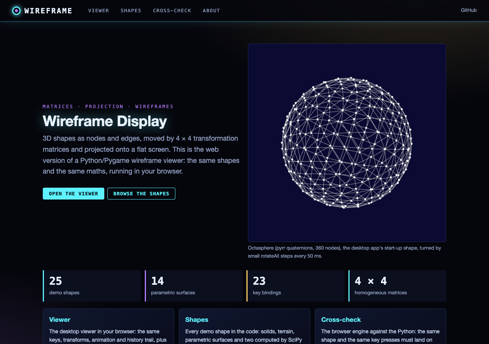
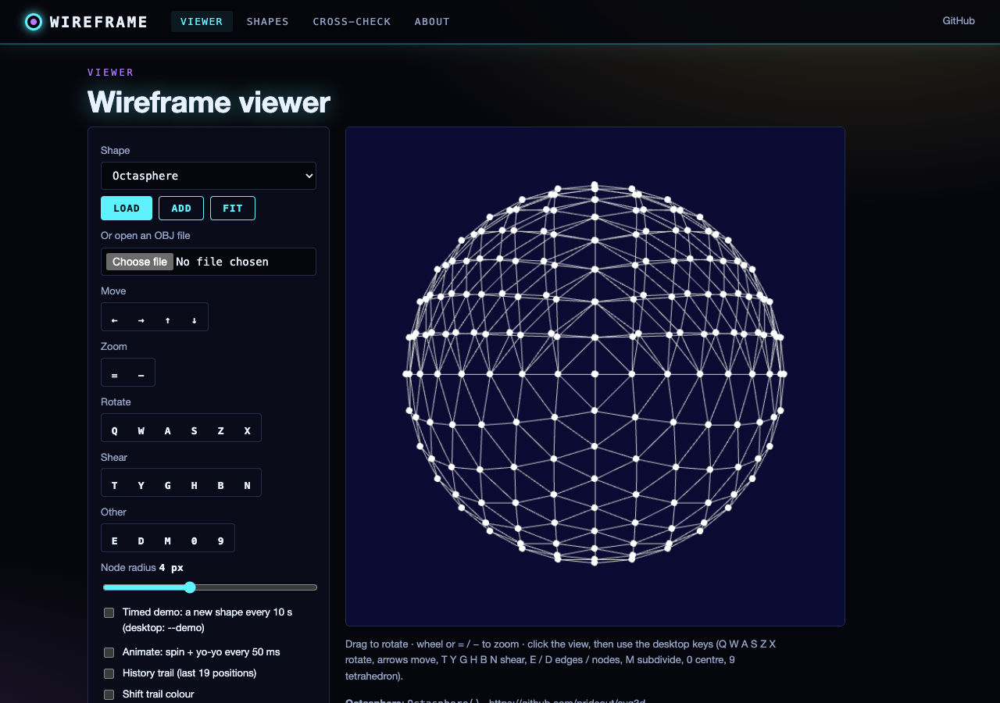
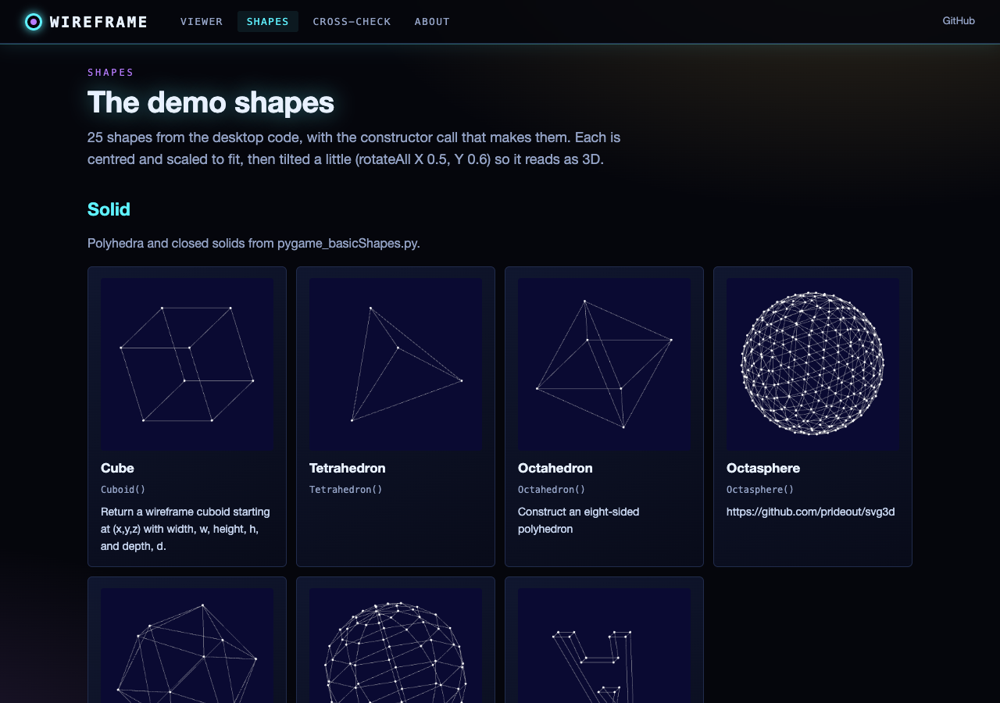
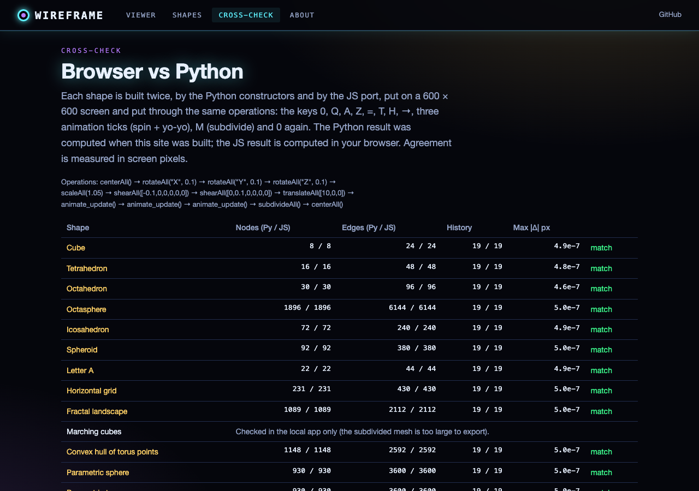

# wireframe_display
 displays 3D projections

Python/Pygame scripts that build 3D wireframes (nodes, edges, faces), move them with 4 × 4 transformation matrices and
draw them on a 600 × 600 window with an orthographic projection. The main viewer is
`pygame_wireframeDisplay/pygame_MatrixDisplay.py`; the folder also holds earlier steps of the same viewer.

**Related repository:** [wireframeDisplay](https://github.com/gddickinson/wireframeDisplay) is a separate, newer
PyQt5/OpenGL scene viewer by the same author. The two share a purpose and a few shapes (e.g. the identical letter-A
geometry, tetra-/octa-/icosahedron, torus, sine surface) but no code: this repository is the Pygame matrix viewer.

## Desktop viewer (Pygame)

```
pip install -r requirements.txt
cd pygame_wireframeDisplay
python pygame_MatrixDisplay.py      # starts with the octasphere; change wf_name at the bottom for another model
```

| Keys | Action |
|---|---|
| arrows | move |
| `=` / `-` | zoom (scale about the screen centre) |
| `Q W` / `A S` / `Z X` | rotate about x / y / z |
| `T Y` / `G H` / `B N` | shear |
| `E` / `D` | show / hide edges / nodes |
| `M` | subdivide triangle meshes |
| `0` | centre |
| `9` | change every shape to the tetrahedron |

The key table and all scene operations live in the Pygame-free `wireframe_scene.py` (shared with the web viewer);
`pygame_MatrixDisplay.py` adds the window, event loop and drawing. Timed demo: `python pygame_MatrixDisplay.py --demo [SECONDS]` shows each demo model for SECONDS (default 10),
scaled to fit, then the next (`WireframeScene.startTimedDemo` / `timedAction`; off by default).

`pygame_wireframe_test.py` and `pygame_wireframe_examples.py` import modules (`wireframe`, `wireframeDisplay`,
`basicShapes`) that are not in this repository, so they do not run as they are.

## Web app and static site

The viewer also runs in the browser: **https://gddickinson.github.io/wireframe_display/** (after Pages is enabled).
The static site *is* the viewer: `web/static/wire_engine.js` and `shapes_engine.js` are ports of the Python wireframe,
scene and shape code, drawn on a canvas, with the desktop keys, drag to rotate, wheel to zoom, the animation and
history-trail switches, all 25 demo shapes (the convex hull and marching cubes, which need SciPy / scikit-image, are
computed by the Python and shipped as data) and opening your own OBJ file. A cross-check page compares the browser
engine with the Python for every shape (agreement about 5e-7 px).

| Home | Viewer |
|---|---|
|  |  |
| **Shapes** | **Cross-check** |
|  |  |

Run the web app locally (FastAPI; serves the catalogue, key table, Python-only shapes and live cross-checks):

```
pip install -r requirements-web.txt
python run_web.py                    # http://127.0.0.1:8118
```

Tests and the static build:

```
python -m pytest -q tests/test_web.py      # API, static export, JS engine vs Python (node)
python -m pytest -q tests/test_desktop.py  # headless regression tests for the Pygame code (needs pygame)
python scripts/make_engine_fixture.py --write   # refresh the Python reference numbers for the JS test
python scripts/build_static.py              # writes site/ (published by .github/workflows/pages.yml)
python scripts/screenshots.py --static --shots "" viewer shapes check   # smoke test + images (Playwright)
```

GitHub Pages: Settings → Pages → Source: "GitHub Actions"; the workflow publishes on every push to main.
